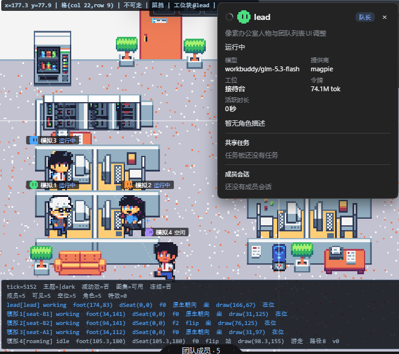

# @zzerx/dsh-plugin-agent-studio

智能体工坊：自定义可复用的单 Agent / 团队 Agent，会话内一键选择启动，每成员独立 preset / 模型 / 上下文。



## 功能

- **智能体与团队管理**：设置页新建 / 编辑 / 删除，支持头像形状、模型、context（fresh/fork）、委派深度。
- **会话内选择**：输入框左侧「智能体」按钮，选中后模型自行判断何时派活 / 创建团队。
- **像素办公室预览**：团队以像素小人在办公室工位实时呈现——干活、游走、完成、失败各有姿态；底部「团队成员」弹出列表，点人物看成员详情（模型 / 令牌 / 任务）。
- **工作预览开关**：设置页可关闭预览（默认开启），关闭后会话头入口隐藏。

## 使用

1. 装进 profile 后，设置侧栏出现「智能体工坊」：新建智能体，填职责描述、选模型，组成团队。
2. 会话输入框左下选「智能体」或「团队」绑定到当前会话。
3. 会话头立方体图标打开像素办公室；立方体线条流动 = 有成员在干活。
4. 不想要预览时，设置页顶部「工作预览」开关可关闭（默认开启）。

## 配置即文件（真源：`<DSH_HOME>/agent_studio.d/`）

智能体与团队是**人可直接编辑的 Markdown**，改文件即生效（设置页与 agent 端读写同一目录）：

```
<DSH_HOME>/storages/agent_studio/
├── agents/frontend-architect.md   文件名 = 智能体 id
├── teams/frontend-squad.md        团队成员按智能体 id 引用
└── bindings/                      会话绑定（storage domain 管理）
```

```markdown
---
displayName: 前端架构师
description: 负责前端方案评审
modelProvider: workbuddy
model: glm-5.3-flash
context: fresh          # fresh / fork
maxDepth: 2
color: 1                # 头像配色档 0..4（可选）
---
正文 = 职责描述（rolePrompt）
```

- 没有 frontmatter 的文件整篇当职责描述，文件名即名字——手写最快路径。
- 设置页编辑 / 手改文件 / agent 改文件是同一个真源，任何一方改完下一帧生效。
- 首次运行会把旧 storage 数据自动迁移成 md；`id` 变更需同步引用它的团队文件。

## 开发

```bash
pnpm --filter @zzerx/dsh-plugin-agent-studio typecheck
pnpm --filter @zzerx/dsh-plugin-agent-studio build
```

美术源图与生成脚本在 `scripts/`（`build-pixel-atlas.mjs` 组装 bg/atlas/可行走网格，`pixel-office-floor.py` 生成地板层）。

MIT License.
